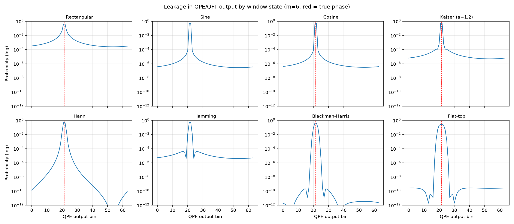
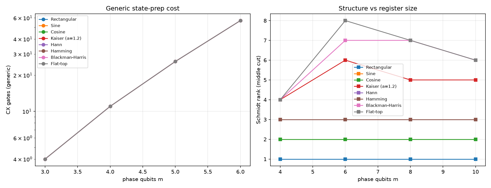

# Mitigation of Spectral Leakage in the Quantum Fourier Transform (QFT) for Non-Periodic Signal Analysis

[](https://www.python.org/downloads/)
[](https://qiskit.org/)
[](https://opensource.org/licenses/MIT)

This repository provides numerical simulations, quantum circuit cost evaluations, and Schmidt rank entanglement benchmarks investigating **spectral leakage mitigation in the Quantum Fourier Transform (QFT) and Quantum Phase Estimation (QPE)** for non-periodic, off-grid signals.

---

## 🔬 Research Overview & Motivation

In standard Quantum Phase Estimation (QPE) and discrete quantum signal processing:
- The phase register is initialized into a uniform superposition using Hadamard gates ($\text{Rectangular}$ window state).
- When the true eigenphase $\phi$ is **on-grid** (i.e. $2^m \phi \in \mathbb{Z}$ for an $m$-qubit register), QPE succeeds with probability $1$.
- However, when analyzing continuous spectra, non-periodic signals, or arbitrary physical Hamiltonians, the true phase almost always lies **off-grid** (between grid points).
- For an off-grid phase, the rectangular state produces severe **spectral leakage**: probability mass decays slowly as $O(1/\Delta k^2)$, spreading errors widely across the register and degrading phase readout fidelity.

### Windowed Quantum State Preparation
By replacing the uniform Hadamard state with a tailored **quantum window state** $|\psi_w\rangle = \sum_{n=0}^{N-1} w_n |n\rangle$ on the phase register, sidelobe levels are drastically suppressed:
- **Baseline Windows**: Rectangular, Sine, Cosine, Kaiser ($\alpha$-tuned via modified Bessel $I_0$).
- **Advanced Cosine-Sum Windows**: Hann, Hamming, Blackman-Harris (4-term), Flat-Top (5-term).

---

## 📊 Key Results

### 1. Leakage Suppression & Sidelobe Mitigation
Simulating an off-grid worst-case phase ($\phi = (19 + 0.5) / 2^m$ with $m=6$, $N=64$ bins):
- **Rectangular**: High sidelobe floor, substantial mass leaks farther than 4 bins away ($\sim 10^{-2}$).
- **Hann & Hamming**: Sidelobes decay rapidly, leakage drops below $10^{-4}$.
- **Blackman-Harris & Flat-Top**: Near-complete sidelobe suppression, with leakage dropping by orders of magnitude ($< 10^{-8}$) and peak sidelobes below $-60\text{ dB}$ to $-90\text{ dB}$.



### 2. State Preparation Gate Cost vs. Schmidt Rank Structure
- **Generic Loading Baseline**: Using arbitrary isometric state synthesis (`qiskit.circuit.library.StatePreparation`), gate depth and CX count grow as $\mathcal{O}(2^m)$ regardless of window shape.
- **Entanglement Structure (Schmidt Rank)**: Evaluating the bipartite Schmidt rank across the middle register cut ($m/2$ qubits):
  - A $K$-term cosine-sum window has an exact mathematical Schmidt rank bound of $\text{Rank} \le 2K - 1$.
  - Hann/Hamming ($K=2$) have Schmidt rank $\le 3$.
  - Blackman-Harris ($K=4$) has Schmidt rank $\le 7$.
  - Flat-Top ($K=5$) has Schmidt rank $\le 9$.
  - In contrast, arbitrary windows (such as Kaiser) exhibit full numerical rank growing with register size $m$.
  - **Implication**: $K$-term cosine windows can be compiled into shallow, structured quantum circuits via Matrix Product State (MPS) or linear-depth Givens-rotation ladders without exponential state preparation overhead.



---

## 📁 Repository Structure

```text
├── qft_window_research.py       # Consolidated end-to-end benchmark (Parts 1, 2, and 3)
├── qft_window_leakage_demo.py   # Module 1: QPE spectral leakage & probability histograms
├── qft_window_cost_demo.py      # Module 2: Generic synthesis gate count & Schmidt rank
├── leakage_comparison.png       # Generated log-probability distribution plots
├── cost_comparison.png          # Generated CX cost & Schmidt rank scaling plots
├── RESEARCH_PAPERS_FOR_UROP.docx# Curated research literature & reference documentation
├── requirements.txt             # Python dependencies
└── README.md                    # Project documentation
```

---

## 🚀 Quickstart & Usage

### 1. Installation
Clone the repository and install dependencies:
```bash
git clone https://github.com/Thenamudhan666/Mitigation-of-spectral-leakage-using-QFT.git
cd Mitigation-of-spectral-leakage-using-QFT
pip install -r requirements.txt
```

### 2. Run the Full Research Benchmark
Executes leakage analysis, optimal Kaiser $\alpha$ tuning, generic transpilation cost benchmarks, and Schmidt rank SVD:
```bash
python qft_window_research.py
```

### 3. Run Individual Demos
- **Leakage Analysis Demo**:
  ```bash
  python qft_window_leakage_demo.py
  ```
- **Circuit Synthesis & Structural Cost Demo**:
  ```bash
  python qft_window_cost_demo.py
  ```

---

## 📚 Academic References

1. **Harris, F. J.** (1978). *"On the Use of Windows for Harmonic Analysis with the Discrete Fourier Transform."* Proc. IEEE, 66(1), 51–83.
2. **Kaiser, J. F., & Schafer, R. W.** (1980). *"On the Use of the $I_0$-sinh Window for Spectrum Analysis."* IEEE Trans. ASSP, 28(1), 105–107.
3. **Rendon, G., Izubuchi, T., & Kikuchi, Y.** (2022). *"Effects of Cosine Tapering Window on Quantum Phase Estimation."* Phys. Rev. D, 106, 034503. [arXiv:2111.13788](https://arxiv.org/abs/2111.13788).
4. **Berry, D. W., et al.** (2024). *"Analyzing Prospects for Quantum Advantage in Topological Data Analysis."* PRX Quantum 5, 010319.
5. **Patel, D., Tan, S. J. S., Subaşı, Y., & Sornborger, A. T.** (2026). *"Optimal Coherent Quantum Phase Estimation via Tapering."* PRX Quantum 7, 020302.
6. **McArdle, S., Gilyén, A., & Berta, M.** (2022). *"Quantum State Preparation Without Coherent Arithmetic."* [arXiv:2210.14892](https://arxiv.org/abs/2210.14892).
7. **Apel, H., Cortes, C. L., Lemieux, J., & Steudtner, M.** (2025). *"Reducing Quantum Resources for Observable Estimation with Window-Assisted Coherent QPE."* [arXiv:2508.06677](https://arxiv.org/abs/2508.06677).
8. **Shukla et al.** (2026). *"Toward Practical Quantum Phase Estimation: A Modular, Scalable, and Adaptive Approach."* Advanced Quantum Technologies (Wiley).

---

## 📄 License
This project is open-source under the MIT License.
